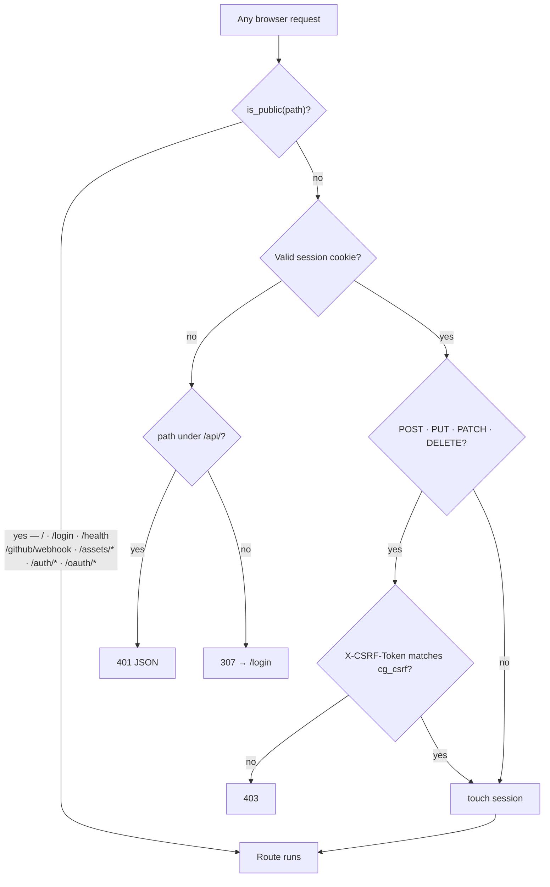
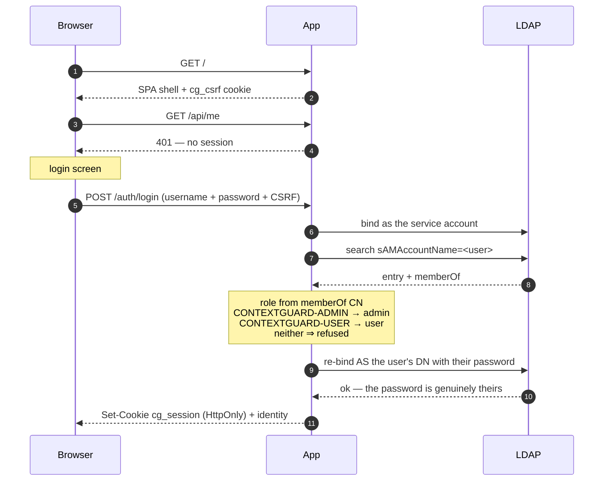
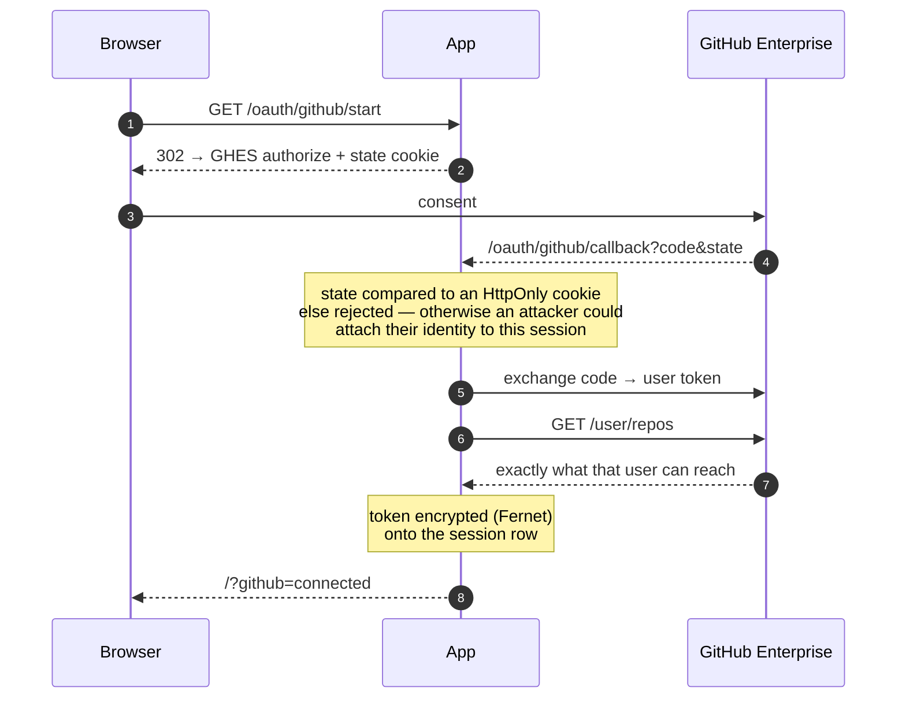
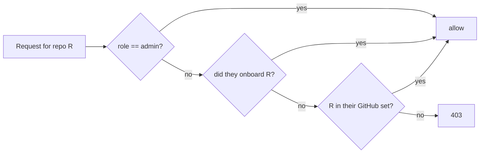
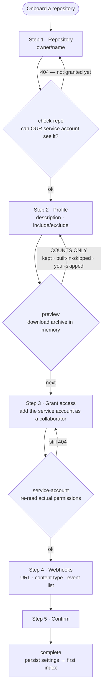
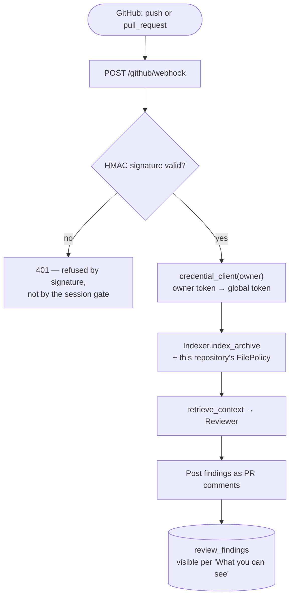

# App-Aware PR Reviewer — Dockerized Context-First MVP

This version puts **persistent application context before PR review**.

## Included
- GitHub `push` and pull-request webhooks with HMAC signature verification.
- Repository archive ingestion at a pinned commit SHA; repository code is never executed.
- Incremental content-hash indexing: unchanged chunks reuse stored embeddings.
- PostgreSQL + pgvector stores versioned chunks and embeddings; PostgreSQL stores symbols and dependency edges.
- Python AST symbol/call/import extraction and lightweight JS/TS/Java symbol extraction.
- Context retrieval combines semantic search and graph-related symbols.
- LLM review report with potential defects, breaking scenarios, test gaps and recommendations.
- Docker Compose, health endpoint and tests.
- React dashboard at `/` (see *Dashboard frontend*) with project onboarding counts, language filtering, inferred application profiles, indexing footprint, PR review history, security/quality findings, and human-managed resolved status.
- Tabbed dashboard — **Overview**, **Applications**, **Security & issues**, **Settings**. Only the selected tab is mounted, and the tab id doubles as the URL hash, so `/#projects` is a working deep link. Insight charts for finding triage, language and review activity, each with a table equivalent. The knowledge graph is exposed through the API only — see *Knowledge graph* below.
- **Applications** is master-detail: pick an application, see its profile and every commit it has (newest first, with when it was reviewed and indexed), then pick a commit to see the reviews that ran against it and the findings they raised — with its own sort control and a table view. There is no separate reviews tab because a review run belongs to a commit.
- `scripts/reindex.py` for regenerating symbols and edges for snapshots indexed before an analyzer change.

This is a functional MVP, not a complete static analyzer. Dynamic dispatch/reflection can defeat static call resolution. JS/TS/Java parsing is heuristic. It does not yet execute generated tests, add inline line comments, or apply fixes.

## Run
1. Copy `.env.example` to `.env` and set GitHub token, webhook secret, LLM and embedding endpoint.
2. **Set the sign-in settings.** `AUTH_REQUIRED` defaults to `true`, and the app **refuses to
   start** unless `LDAP_SERVER`, `LDAP_BASE_DN` and `LDAP_BIND_DN` are all set. That is intentional
   — the alternative is coming up in a state nobody can log into. For a local trial only, set
   `AUTH_REQUIRED=false`, which opens the dashboard to anyone who can reach the port. Set
   `GITHUB_API_URL` too if you are on GitHub Enterprise — see *Authentication and repository
   access* below.
3. Start: `docker compose up --build -d`
3. Open the dashboard: `http://localhost:8000/`
4. Check health: `http://localhost:8000/health` — public, so it works without a session.
5. View logs: `docker compose logs -f app`

`docker compose up --build` compiles the dashboard from source as part of the image build, so no
Node toolchain is needed to run the app.

## Dashboard frontend

The dashboard is a React + TypeScript + Tailwind single page app in `frontend/`. Its production
build is written to `app/static/`, which the FastAPI app serves: `GET /` returns the shell and
`/assets/*` serves the hashed bundles.

```
frontend/
  index.html          Vite entry point
  vite.config.ts      root/base/outDir and the dev proxy
  src/
    lib/              API client, formatters, hooks, design tokens mapping
    components/       layout, ui primitives, and one folder per dashboard section
```

**Local development.** Run the API and the Vite dev server side by side:

```bash
uvicorn app.main:app --port 8000      # terminal 1
cd frontend && npm install && npm run dev   # terminal 2
```

Open `http://localhost:5173`. The dev server proxies `/api` and `/health` to `127.0.0.1:8000`, so
both run same-origin and no CORS middleware is involved in either environment.

**Building.** `cd frontend && npm run build` type-checks and writes the bundle to `app/static/`.
The build is required before a bare `uvicorn app.main:app` can serve the dashboard — without it
`GET /` returns a 503 explaining exactly that. The built output is git-ignored, because the Docker
build stage regenerates it.

Frontend dependencies are pinned by `frontend/package-lock.json`, which the image installs with
`npm ci`. It is generated by `npm install` and should not be hand-edited.

## Dashboard behavior
- A repository appears after its first successful push/index event. Existing snapshots are backfilled into the catalog at startup; their language and description are enriched after the next push.
- Application descriptions are inferred from README files and supported manifests (for example `package.json` and `pyproject.toml`); they are not yet a generated product brief from an LLM.
- Review totals and findings are recorded from webhook-driven pull-request reviews after this version is deployed. Previous PR reviews are not imported automatically.
- Finding statuses start as `open`. Status is set only from GitHub — see *Triage* below. This is a tracking action, not proof that a test ran or that the issue cannot recur.
- Read endpoints: `GET /api/dashboard`, `GET /api/findings`, `GET /api/reviews`, `GET /api/repositories/{owner}/{repo}`, `GET /api/repositories/{owner}/{repo}/commits`, `GET /api/graph`. There is deliberately no endpoint that mutates a finding's status.
- `GET /api/findings` is the filterable view: `repo`, `language`, `status`, `severity` and `commit` (all optional, `all` means "no filter"), plus `sort` — one of `severity` (default), `recent`, `oldest`, `file`, `category`, `project` — and `limit`. It exists separately from `/api/dashboard` because that payload caps findings at the 20 most severe rows, which would silently miss most filter matches, and `language` and `commit` are not in it at all. Sort keys are a whitelist rather than interpolated, since an `ORDER BY` cannot be parameterised.
- `GET /api/reviews` filters review runs by `repo`, `language`, `commit` and `risk`, the same way.
- `GET /api/repositories/{owner}/{repo}/commits` unions the commits a repository was *indexed* at with the commits a review *ran against*, newest first, carrying the review and finding counts for each. That is what the Applications drill-down is built on.
- The filter endpoints return their own option lists, drawn from the whole table rather than the current result, so choosing one filter never removes the choices from the others.
- The dashboard is read-only apart from credential management. Section navigation is in-page anchors, so there is no client-side router and no deep links: `#overview`, `#workflow`, `#projects`, `#reviews`, `#findings`, `#settings`. Applications filtering (`language`, `q`) is applied by the API; finding status and severity are filtered in the browser over the rows the API returned, because `/api/dashboard` has no parameters for them.

## Authentication and repository access

Sign-in is **LDAP**; which repositories you can see is **GitHub**. They are deliberately separate:
the directory answers "who are you" and "are you an admin", and GitHub answers "what can you
reach", because only GitHub knows that. `AUTH_REQUIRED` defaults to true, and with it on every
route except the ones listed below needs a session.

When `AUTH_REQUIRED` is on but `LDAP_SERVER`, `LDAP_BASE_DN` or `LDAP_BIND_DN` is unset, the app
**refuses to start**. That is deliberate: the alternative is coming up in a state nobody can log
into. Set `AUTH_REQUIRED=false` only for a local trial — it makes the dashboard open to anyone who
can reach the port.

### Every request



This is an **allowlist**: only the paths named above are reachable without a session, so a route
added later is protected by default. A test walks every declared route and fails if one is
reachable without a session, and another confirms lookalikes (`/assetsomething`, `/healthz`,
`/authx`) are not public — a prefix check missing its trailing slash would have let those through.

`/github/webhook` is public because GitHub cannot present a session; it authenticates by HMAC
signature instead, and a test asserts it *reaches* that check rather than being stopped here.

### Signing in



Passwords are never stored, compared or logged: the re-bind is what proves the password belongs to
the user. The username is escaped before it reaches an LDAP filter, and membership is checked
*before* the password is ever sent. Group matching is on the **CN**, so moving a group between OUs
does not silently revoke everyone; a configured value containing `=` is treated as a full DN.

### Connecting GitHub



Our service account **cannot** answer "what can this person see" — that requires acting as them,
which is the whole reason this flow exists. The user token is encrypted with the same key as owner
credentials; if `GITHUB_CREDENTIAL_KEY` is unset the callback refuses rather than storing it in the
clear.

### What you can see



For list endpoints (`/api/dashboard`, `/api/findings`, `/api/reviews`) the rule becomes a SQL
predicate rather than a post-filter, so an invisible repository is never loaded. An empty scope
means *show nothing*, not *show everything*. A user who has not connected GitHub still sees the
repositories they onboarded, so their dashboard is never blank.

### Onboarding a repository

Every step is gated on a real API call against your GitHub — a step only turns green when the call
succeeds, so "it looks right" is never enough.



Step 2 reports how many files the **built-in** filters skip, but never names them — see
*Repository exclusions* below.

### The review path, for context



## Repository exclusions

Two layers, applied in order, and the difference is visible to users:

1. **Built-in filters** — `SKIP_DIRS`, the suffix blocklist and `TEXT_EXTS` in `app/repository.py`.
   These decide what is indexable at all. They are **never named in any API response or UI**; the
   onboarding preview reports only a count.
2. **Per-repository patterns** — `include_patterns` / `exclude_patterns` in `repository_settings`,
   edited in the onboarding wizard or the application detail. Exclude always beats include, and an
   **empty include list means "everything not excluded"**, not "nothing".

A repository with no settings row resolves to an empty policy, which allows everything — so
repositories onboarded before this feature existed index exactly as they did before.

## Per-owner credentials

`GITHUB_TOKEN` in `.env` is the **default** credential. The dashboard's **Settings** section stores an
additional token per owner/organisation, which then covers every repository under that owner.
Resolution order is: stored owner credential → `GITHUB_TOKEN`.

- Tokens are encrypted at rest (Fernet) and are **write-only** — no endpoint ever returns one, only a
  masked hint. Every create/update/delete/verify is recorded in `credential_audit` with the requestor's address.
- **`GITHUB_CREDENTIAL_KEY` must be backed up with `.env`.** Losing it makes every stored credential
  permanently undecryptable and they must all be re-entered.
- On save the token is validated against GitHub. This proves the token is **live** and can **see the
  owner** — it does *not* prove it has Pull requests:write, because fine-grained PATs expose no scopes
  or permission bits over REST. An under-scoped token passes validation and only fails at review time.
- If a stored token is rejected (401/403) during a review, the failure is recorded against that
  credential, shown in Settings, and the request is retried once with `GITHUB_TOKEN` so reviews keep working.
- **⚠ These endpoints have no authentication.** Anyone who can reach the app can add, replace or
  delete credentials, and can list which owners are configured. They cannot read any token. Set
  `GITHUB_SETTINGS_ADMIN_TOKEN` to require an `X-Admin-Token` header on writes, keep the app off the
  public internet (including tunnels), and add real auth before any shared deployment.

## Triage

Each finding is posted as its **own** PR comment, anchored to the offending diff line where one can be resolved and posted as a standalone comment otherwise. The combined summary comment is still posted as the PR overview.

A reviewer can set status in either of two ways:

1. **Reply with a command**
   - On an **inline** comment, reply to that comment: `/resolved` or `/invalid`
   - On a **standalone** comment (a timeline comment cannot be threaded), post a **new top-level** comment carrying the finding id: `/resolved 42` or `/invalid 42`
2. **Click GitHub's "Resolve conversation" button** on an inline finding comment. Unresolving it puts the finding back to `open`.

Either way the app applies the status and edits the finding's own comment to show a banner (`> ✅ Resolved — set by @you`) so nobody re-reviews a closed finding. Repeating a command, redelivering an event, or toggling the button is idempotent.

Configure your GitHub App webhook URL as `https://YOUR_HOST/github/webhook` and subscribe to **Push**, **Pull request**, **Pull request review comments**, **Pull request review threads** and **Issue comments**, using the same webhook secret. Required permissions: **Contents read/write**, Pull requests read/write, Issues read/write, Metadata read.

- *Pull requests: write* is required to create and edit review comments. *Issues: write* alone is **not** sufficient to comment on a pull request — GitHub gates PR comments on the Pull requests permission.
- *Contents: write* is required only to auto-resolve review threads, and is an undocumented GitHub quirk: the `resolveReviewThread` GraphQL mutation is refused with `FORBIDDEN` under a Contents-read token even though it creates no commit, changes no file and moves no ref. Without it, settled findings leave an open conversation behind, which blocks merging on a branch with "Require conversation resolution before merging". Grant it only if you want the app to manage thread state; otherwise reviewers must click *Resolve conversation* themselves.

Note: these event subscriptions are a *webhook setting*, not a token scope — no extra PAT permission is needed for them.

## Embeddings
The schema uses `vector(1536)`. The embedding model must return exactly 1536 dimensions. Default: `text-embedding-3-small`. If your provider uses another dimension, update both `EMBEDDING_DIMENSIONS` and the `vector(1536)` column in `app/db.py`. Some OpenAI-compatible providers do not offer embeddings.

## Context update strategy
Each snapshot is pinned to a commit SHA. Chunk IDs are stable for path + chunk number; hashes allow embedding reuse across snapshots. New snapshot rows are committed transactionally, and repeated indexing of the same commit is idempotent. The PR reviewer queries the PR head snapshot.

## Knowledge graph

Indexing extracts symbols into `code_symbols` (nodes) and their call/import relationships into
`code_edges` (edges). The reviewer uses them as extra context: for each changed file it loads that
file's symbols and walks one hop of outgoing edges, so a pull request that touches a shared helper
pulls in its callers' context as well. This is what `type: "symbol_graph"` in the retrieved context
refers to.

Extraction is AST-based for Python, and regex-based for JS/TS/JSX in `app/analyzer.py`. The JS/TS
pass is a heuristic, as noted above: it cannot resolve types or scopes, so it attributes a call to
the nearest preceding declaration in the file. Precision is protected by a deliberately strict rule
— a relationship is only recorded when the target name matches **exactly one** symbol in the whole
repository. Ambiguous names such as `render` or `__init__` therefore produce no edge at all.

Two read-only endpoints expose it:

- `GET /api/graph` — per-repository coverage (symbols, linked symbols, isolated symbols,
  relationships) and the most connected symbols overall.
- `GET /api/repositories/{owner}/{repo}/graph` — the connected subgraph for one repository, capped
  to the most connected nodes.

**The graph has no UI.** Both endpoints are live and the graph is fully built and used during
review, but the dashboard shows nothing from it: a force-directed rendering crashed browsers on
this machine and could not be reproduced headlessly, so the view was removed rather than left in
as a crash. The endpoints above are available for any future view.

### Re-indexing after an analyzer change

Indexing skips any `(repository, commit)` pair already on record, so a repository indexed *before*
an analyzer change keeps its old symbols and edges indefinitely — pushing to the same commit will
not refresh them. Re-run indexing for the snapshot already stored:

```bash
docker compose exec app python scripts/reindex.py --all
docker compose exec app python scripts/reindex.py owner/name owner/other
```

Embeddings are reused by content hash, so re-indexing an unchanged commit makes **no** embedding
calls. It does re-download each repository archive from GitHub, which needs a working credential.
This is a CLI rather than an endpoint on purpose — an unauthenticated HTTP route that downloads
repository archives on demand would be an easy way to exhaust the host.

## Test
`pip install -r requirements.txt && pytest -q`

## Production hardening
Add authentication in front of the dashboard and Settings before exposing this beyond a trusted network — the credential endpoints are ungated by default. Use GitHub App installation tokens, a background queue, retries/backoff, delivery idempotency, rate-limit handling, audit logs, repository quotas, and monitoring. For large repos, move indexing out of webhook requests. Source files are untrusted input; never run them in the indexer.
